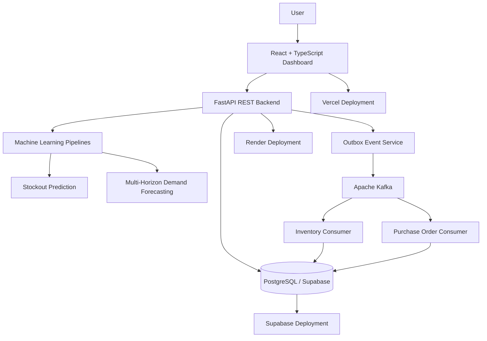

# MediSupplyAI — Intelligent Medical Supply Chain Management

**A full-stack medical inventory and supply chain management platform with machine learning-based stockout prediction, multi-horizon demand forecasting, and event-driven processing.**

<p align="center">
  <a href="https://medi-supply-ai.vercel.app">Live Application</a> •
  <a href="https://medisupply-ai.onrender.com/docs">Backend API Documentation</a> •
  <a href="https://github.com/MohdGhouse04/MediSupply-AI">GitHub Repository</a>
</p>

## Overview

MediSupplyAI is an intelligent medical supply chain management platform designed to help healthcare facilities monitor medicine inventory, identify potential stock shortages, manage medicine batches, and support procurement and stock transfer decisions.

The platform combines a React-based dashboard, FastAPI backend, PostgreSQL database, machine learning forecasting pipelines, and Apache Kafka-based event processing.

It provides centralized visibility into inventory across multiple facilities and supports data-driven inventory management.

## Key Features

### Inventory Management
- Monitor medicine stock across healthcare facilities.
- Track inventory quantities and medicine batches.
- View inventory summaries and low-stock information.
- Maintain inventory transaction records.

### Stockout Prediction and Alerts
- Generate machine learning-based stockout risk alerts.
- Categorize alerts by risk level.
- View alert history and acknowledge alerts.
- Synchronize generated stockout predictions with the backend database.

### Demand Forecasting
- Generate multi-horizon demand forecasts.
- Support 7-day, 14-day, 30-day, and 60-day forecast horizons.
- Provide forecast data through backend APIs.

### Expiry Management
- Track medicine batch expiry dates.
- Provide expiry-related risk information and recommendations.
- Support FEFO (First Expiry, First Out) recommendations.

### Procurement Management
- View procurement recommendations.
- Create and manage purchase orders.
- Track purchase order status and receiving operations.

### Inter-Facility Transfers
- Manage stock transfers between healthcare facilities.
- View transfer recommendations.
- Track transfer status.

### Event-Driven Processing
- Apache Kafka-based event messaging.
- Outbox pattern for reliable event publishing.
- Separate inventory and purchase-order consumer services.
- Processed-event tracking for event deduplication.

## System Architecture



**Deployment architecture:** The frontend is hosted on Vercel, the FastAPI backend on Render, and PostgreSQL on Supabase. Kafka and its associated worker/consumer services are configured for local Docker-based execution.

## Technology Stack

| Component | Technologies |
|---|---|
| Frontend | React 19, TypeScript, Vite |
| UI and Charts | CSS, Lucide React, Recharts |
| Backend | Python, FastAPI |
| Database | PostgreSQL, SQLAlchemy |
| Data Processing | Pandas, NumPy |
| Machine Learning | Scikit-learn, Joblib |
| Event Streaming | Apache Kafka, kafka-python |
| Architecture | REST APIs, Outbox Pattern, Event-Driven Processing |
| Database Migrations | Alembic |
| Testing | Pytest, Playwright |
| Containerization | Docker, Docker Compose |
| Frontend Hosting | Vercel |
| Backend Hosting | Render |
| Database Hosting | Supabase |

## Project Structure

```text
MediSupply-AI/
│
├── backend/
│   └── app/
│       ├── api/             # REST API endpoints
│       ├── core/            # Application configuration
│       ├── database/        # Database connection and base
│       ├── models/          # SQLAlchemy models
│       ├── schemas/         # Pydantic schemas
│       ├── services/        # Business logic and event services
│       └── main.py          # FastAPI application
│
├── frontend/
│   └── src/
│       ├── pages/           # Dashboard pages
│       ├── services/        # API integration
│       └── App.tsx
│
├── ml/
│   ├── data/                # ML datasets and generated outputs
│   ├── evaluation/          # Model evaluation scripts
│   └── models/              # Training and forecasting scripts
│
├── migrations/              # Alembic database migrations
├── scripts/                 # Kafka and utility scripts
├── data/                    # Processed forecast data
├── Dockerfile
├── docker-compose.yml
├── requirements.txt
└── README.md
```

## Local Setup

### Prerequisites

- Python 3.13+
- Node.js and npm
- PostgreSQL
- Docker Desktop
- Git

### 1. Clone the repository

```bash
git clone https://github.com/MohdGhouse04/MediSupply-AI.git
cd MediSupply-AI
```

### 2. Set up the Python environment

```bash
python3 -m venv .venv
source .venv/bin/activate
pip install -r requirements.txt
```

### 3. Configure environment variables

Create your local environment file using `.env.example` as a reference.

Configure the database connection and other required application settings. Never commit credentials or production secrets.

### 4. Set up the frontend

```bash
cd frontend
npm install
```

Create `frontend/.env` and configure the backend URL:

```env
VITE_API_BASE_URL=http://localhost:8000
```

Start the frontend development server:

```bash
npm run dev
```

### 5. Start the backend

From the project root, configure a working PostgreSQL database and apply migrations:

```bash
python -m alembic upgrade head
```

Start FastAPI:

```bash
uvicorn backend.app.main:app --reload
```

Backend API: `http://localhost:8000`

Interactive API documentation: `http://localhost:8000/docs`

### 6. Run Kafka services

The Docker Compose configuration includes Kafka, the API container, the outbox worker, and the inventory and purchase-order consumers.

Configure the local database connection and required environment variables before starting the services.

```bash
docker volume create medisupply-kafka-data
docker compose up --build
```

## Deployment

| Component | Platform | Deployment |
|---|---|---|
| Frontend | Vercel | [Open Application](https://medi-supply-ai.vercel.app) |
| Backend | Render | [Open API](https://medisupply-ai.onrender.com) |
| Database | Supabase | PostgreSQL |

The production frontend communicates with the deployed FastAPI backend using `VITE_API_BASE_URL`.

The backend uses configured CORS origins to permit requests from the deployed frontend.

**Deployment note:** Kafka and its associated workers are currently configured for local Docker execution and are not part of the public cloud deployment.

Free-tier hosting can introduce cold starts and service limits.

## Testing and Validation

The following checks were completed during development:

| Test | Result |
|---|---|
| Backend test suite | 85 passed |
| Frontend Playwright tests | 8 passed |
| Frontend TypeScript check | Passed |
| Frontend production build | Passed |
| Git whitespace validation | Passed |
| Docker image build | Passed |
| Production backend health check | HTTP 200 |
| Production frontend smoke test | Passed |

## Current Limitations

- The dashboard demand chart contains illustrative visualization data and should not be interpreted as live model output.
- Stockout alert freshness depends on the latest generated prediction dataset.
- Expiry forecasts are limited by the available forecast horizon; batches beyond that horizon may not have forecast coverage.
- Kafka workers currently run in the local Docker environment rather than the public cloud deployment.

## Future Improvements

- Deploy Kafka and event consumers to a cloud environment.
- Automate scheduled model retraining and forecast generation.
- Extend forecast coverage for longer-term expiry analysis.
- Add monitoring, logging, and automated deployment workflows.
- Improve model explainability and prediction evaluation.

## Author

**Mohd Ghouse**

B.Tech — Computer Science and Engineering (AI & ML)

GitHub: [MohdGhouse04](https://github.com/MohdGhouse04)

---

**MediSupplyAI — Intelligent and data-driven medical supply chain management.**